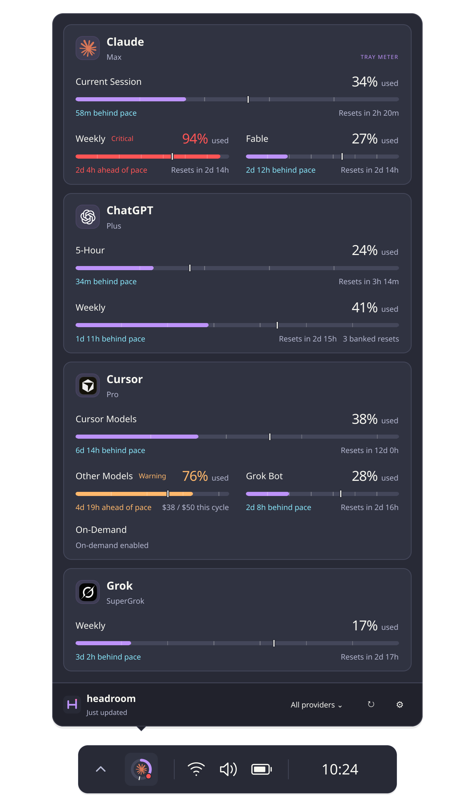

# Headroom

**Know how much AI usage you have left, without checking four dashboards.**

Headroom brings Claude, ChatGPT, Cursor, and Grok usage into one tray app for
Windows, macOS, and Linux. See your remaining allowance, when limits reset, and
whether you're on pace to run out. Prefer the terminal? The same installation
includes a live CLI dashboard.

[](https://github.com/AaronFeledy/headroom/actions/workflows/build.yml)
[](https://github.com/AaronFeledy/headroom/releases/latest)
[](LICENSE)



## Why Headroom?

- **One place for your limits.** Track session, weekly, model, and credit meters
  as reported by each provider.
- **A glance instead of a dashboard visit.** Keep your preferred provider's usage
  in the tray; drag provider rows to change the order.
- **A warning before you run out.** See reset countdowns and estimated usage pace,
  with desktop alerts when usage enters Warning or Critical.
- **Desktop or terminal, local or remote.** Use your existing sign-ins on this
  computer, or monitor a server over SSH or HTTPS.

## Install

The installer selects the latest stable package for your OS and CPU, verifies
it, and installs it for your user. Desktop packages include the app, local usage
server, and CLI; no separate Qt or Go installation is needed.

### Windows

Run in PowerShell 5.1 or newer:

```powershell
irm https://raw.githubusercontent.com/AaronFeledy/headroom/main/install.ps1 | iex
```

### macOS and Linux

Requires `curl`, `tar`, and Python 3. On macOS, install Python 3 first if it isn't
available, using Apple Command Line Tools or your package manager.

```bash
curl -fsSL https://raw.githubusercontent.com/AaronFeledy/headroom/main/install.sh | sh
```

| Platform | Desktop support |
| --- | --- |
| Windows | x64: Windows 10 1809+; ARM64: Windows 11 |
| macOS | Apple Silicon and Intel, macOS 14.4+ |
| Linux | x86_64, Ubuntu 22.04-compatible desktop libraries; X11 and Wayland |

Linux ARM64 is supported by the [CLI-only package](#cli-only-installation).
macOS packages are ad-hoc signed, **not Developer ID signed or Apple-notarized**.
Use the installer rather than moving the internal app bundle out of a release archive.
See [releases](https://github.com/AaronFeledy/headroom/releases/latest) for
downloads and [packaging](packaging/README.md) for custom paths and Linux runtime
dependencies.

If you reinstall while Headroom is open, quit and reopen it afterward.

## Get started

1. **Open Headroom.** The installer launches the desktop app. Later, open it from
   the Windows Start menu, `~/Applications/Headroom.app` on macOS, or the Linux
   application menu. You can also run `headroom desktop`.
2. **Keep Local mode for this computer.** Headroom connects to a compatible local
   server or starts its bundled server automatically. No server setup is needed
   for the usual desktop installation.
3. **Check your sign-ins.** Headroom reads existing provider credentials on the
   computer running the server. If a provider needs attention, follow its sign-in
   prompt; run any suggested command yourself on that computer.

| Provider | Where Headroom looks for a sign-in |
| --- | --- |
| Claude | Claude Code credentials, with an OpenCode fallback |
| ChatGPT | Codex CLI credentials, with an OpenCode fallback |
| Cursor | cursor-agent, the Cursor app, or supported browser sign-ins |
| Grok | Grok CLI credentials, with a browser sign-in fallback |

Windows desktop packages can share supported Cursor and Grok browser sign-ins
with the server. Control this with **Share browser sign-ins with the server** in
Settings. The [provider guide](server/README.md#configuration) covers credential
locations, WSL discovery, and disabling providers you don't use. ChatGPT is named
`Codex` in server configuration and the API.

Click the tray icon to see your meters. Drag your main provider to the top to use
it for the tray meter, and enable **Start Headroom when I sign in** in Settings
if you'd like it available at login. Usage pace is an estimate; the
[desktop guide](clients/desktop/README.md) explains the indicators and alerts.

## Use it in the terminal

With the desktop open or a server already running:

```sh
headroom                 # live dashboard in a terminal
headroom --once          # one snapshot
headroom --json          # one snapshot as JSON
```

With no explicit address, the CLI uses the running desktop's selected connection
and provider order. If no desktop is running, it tries `127.0.0.1:7823`.
**Displaying usage does not start a server.** Piped output prints once by default.

On Windows, open a new terminal after installation to pick up the CLI on PATH.
On Linux and macOS, ensure `~/.local/bin` is on your PATH.

### CLI-only installation

For a terminal, WSL, or a server without a desktop, install the CLI-only package.
It includes the usage server without Qt, and supports Windows
x64/ARM64, Linux x86_64/ARM64, and macOS Intel/Apple Silicon.

```sh
curl -fsSL https://raw.githubusercontent.com/AaronFeledy/headroom/main/install.sh | sh -s -- --cli
```

On Windows, download [install.ps1](install.ps1), then run `./install.ps1 -CLI`
in PowerShell.

CLI-only installation does not start a server. To monitor this computer, run:

```sh
headroom serve
```

Leave it running, then use `headroom` in another terminal. The server reads your
existing provider sign-ins and listens on `127.0.0.1:7823` by default. For automatic
startup, see the [Linux/WSL service setup](docs/cli.md#linux-and-wsl-automatic-server-startup).
The [CLI guide](docs/cli.md) covers filtering, scripting, and connection options.

## Connect to another computer

Run the usage server where your provider credentials live, then choose its
connection in desktop Settings. **SSH is recommended for Linux and WSL servers**;
it uses your OpenSSH keys and trusted hosts. Follow the [SSH setup guide](docs/ssh.md).
Direct HTTP(S) connections are also available; use HTTPS for remote access.

The server requires an access token before listening beyond localhost. Saved
direct-connection tokens are stored in the desktop settings file, so treat it as
sensitive. Browser sign-ins are shared only with a verified bundled local server,
an HTTPS server with a verified certificate, or an SSH connection. See the
[server guide](server/README.md) for configuration and deployment details.

## Help

- **A provider asks for sign-in:** sign in on the server's computer, as the user
  running it. For a WSL server, run the suggested command inside WSL.
- **No usage in the terminal:** open the desktop or start `headroom serve`, then
  check the provider sign-in status.
- **The desktop can't connect:** check Settings and diagnostics. An official
  installation can offer **Repair installation** for a missing bundled component.
- **Need to report a problem?** [Open an issue](https://github.com/AaronFeledy/headroom/issues)
  with your OS, Headroom version, and redacted diagnostics. Never include tokens,
  provider credentials, or browser cookies.

## Documentation

| Guide | What's inside |
| --- | --- |
| [Desktop](clients/desktop/README.md) | Settings, shortcuts, notifications, troubleshooting, and source builds |
| [CLI](docs/cli.md) | Terminal options, services, source builds, and Windows/WSL pairing |
| [Server](server/README.md) | Provider configuration, API, Docker, and deployment |
| [SSH](docs/ssh.md) | Remote server setup and authentication |
| [Home Assistant](docs/home-assistant.md) | REST sensors; no add-on required or supplied |
| [Stream Deck](clients/streamdeck/README.md) | Build and install the optional plugin from source |
| [Packaging](packaging/README.md) | Install locations and runtime dependencies |

Building or contributing? Start with the component guides above and the
[repository guidelines](AGENTS.md) for the verification matrix.

## License

[MIT](LICENSE)
